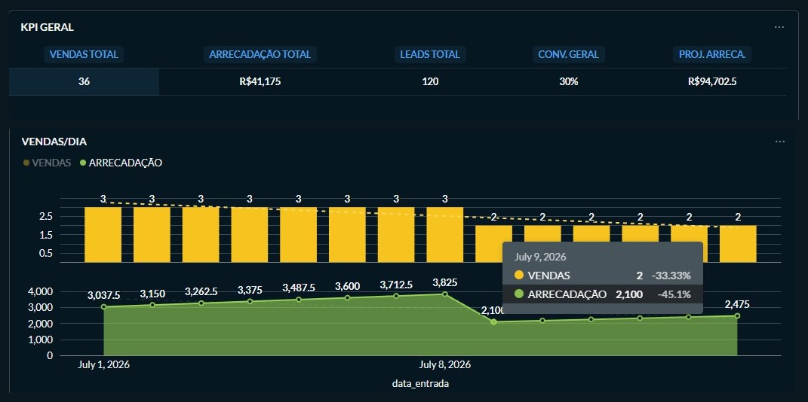
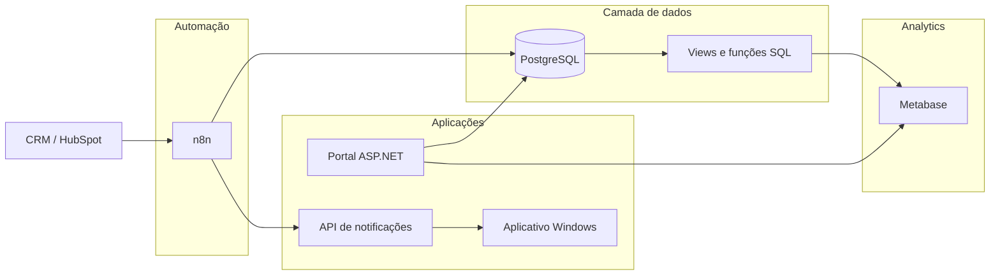
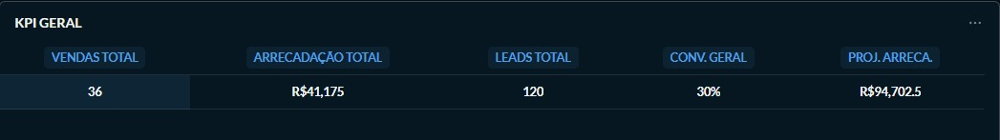
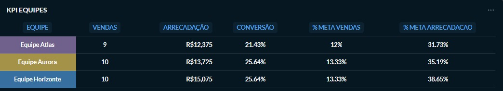
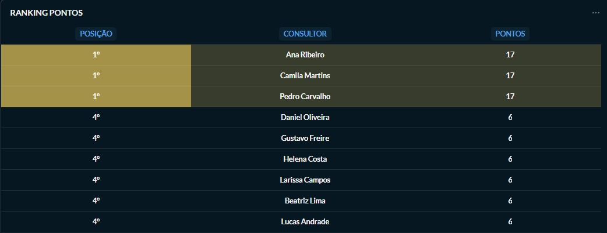
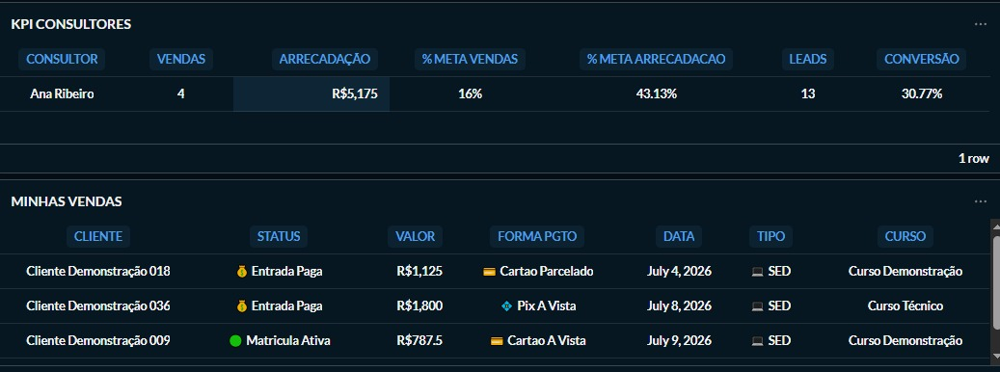
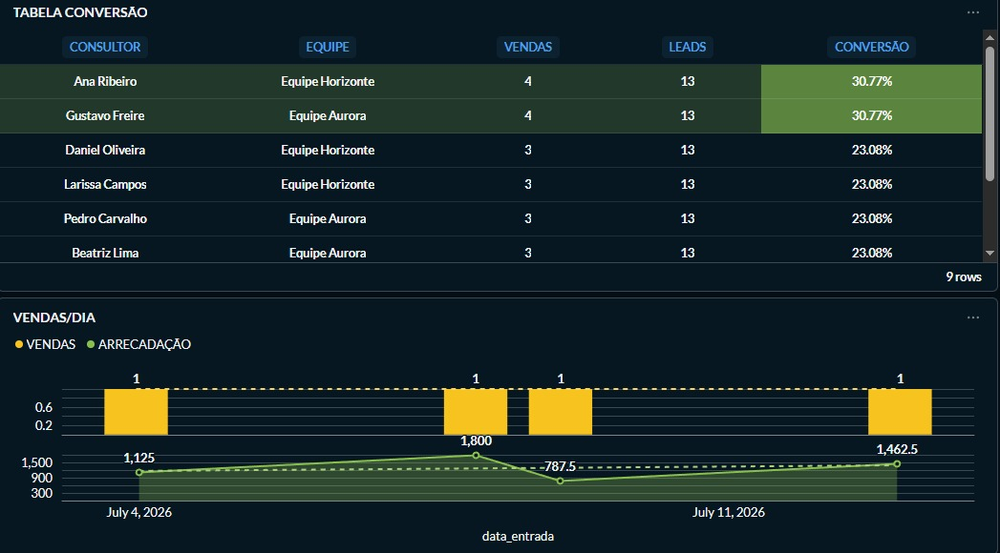
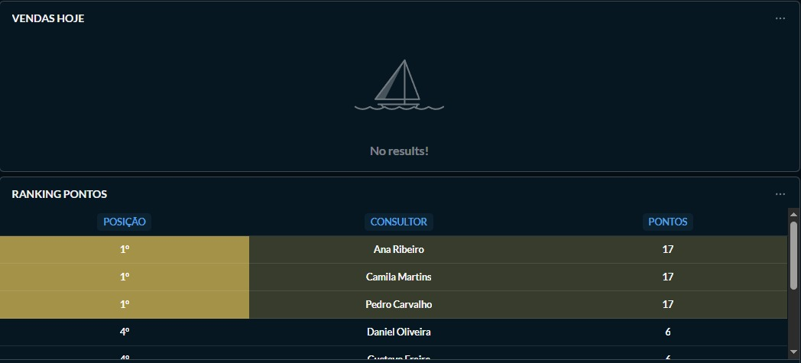

# Ecossistema Comercial de Automação e BI

Integrei HubSpot, n8n, PostgreSQL e Metabase para a equipe comercial de uma operação real, de cerca de 30 pessoas. Uma venda nova passou a aparecer no dashboard e num aviso no computador da equipe **em menos de 5 minutos**, em horário comercial; antes, a equipe dependia do KPI do dia anterior ou de abrir o HubSpot para conferir. O sistema sincroniza **15 a 25 mil leads e 500 a 600 vendas por mês** e eliminou de **2 a 5 horas semanais** de consultas, exportações e relatórios manuais.

<p align="center">
  
  <br>
  <sub>Visão da gestão no Metabase, com dados fictícios do banco de demonstração.</sub>
</p>

| | Antes | Depois |
|---|---|---|
| Venda nova visível para a equipe | KPI do dia anterior, ou abrir o HubSpot | **menos de 5 minutos** em horário comercial, no dashboard e num aviso no computador |
| Consultas, exportações e relatórios | **2 a 5 h por semana**, à mão | automáticos |
| Quem usa | — | **cerca de 30 pessoas**: vendedores, supervisores e gestão, cada um vendo só o que lhe cabe |
| Volume sincronizado | — | **15 a 25 mil leads** e **500 a 600 vendas** por mês |

## Como foi construído

Levou de 1 a 2 meses, durante o estágio. Usei o **ChatGPT como assistente de código**: descrevia o que cada parte precisava fazer (endpoints em C#, views e funções SQL, nós e transformações do n8n), pedia o código e colava nos arquivos que criava no VS Code. Não havia agentes nem assistente dentro do editor; a IA entrava conversa a conversa, uma peça por vez.

## O que eu faria diferente hoje

O código está como foi feito na época. Revisando hoje, eu mudaria:

1. **Avisos em fila.** O aplicativo consulta só a última notificação. Duas vendas na mesma execução do n8n (a cada 5 minutos) viram um aviso só. Hoje ele guardaria a hora do último aviso exibido e buscaria tudo o que chegou depois.
2. **Consultas com parâmetros.** O fluxo de vendas monta o SQL colando os valores do CRM. Um nome com apóstrofo (Sant'Anna) quebra a execução e trava a sincronização até alguém corrigir o cadastro. Hoje usaria parâmetros (`$1`, `$2`) no nó do PostgreSQL, o que também fecha a porta para injeção de SQL.
3. **Uma definição só de venda válida.** O dashboard conta 11 status; o aviso de venda, 2 status por nome exato; o cálculo de meta, os mesmos 2 por semelhança. Hoje seria uma tabela de status com uma coluna "conta como venda", usada pelos três.
4. **Datas com fuso.** As datas chegam do CRM em UTC e são gravadas em colunas sem fuso, e o controle do fluxo de leads guarda o horário de Brasília sem fuso. Hoje usaria `timestamptz` e converteria para America/Sao_Paulo só na exibição.
5. **Vendedor ligado por ID.** As views ligam venda e vendedor pelo ID do CRM, pelo ID interno ou pelo nome, e a meta notificada usa o nome como chave. Hoje a sincronização gravaria o `vendedor_id`.
6. **Testes automáticos.** Não há verificação automática. Hoje rodaria o schema, o seed e as validações SQL a cada mudança, como faço no [tiktok-shop-ia](https://github.com/joaopedromc-git/tiktok-shop-ia).

## Sobre esta versão

Este repositório é uma versão sanitizada do projeto, organizada como portfólio. Nomes, identificadores, credenciais, endereços e dados do ambiente original foram removidos ou substituídos por informações fictícias. Os dashboards aparecem com os dados do banco de demonstração incluído aqui.

---

## Visão geral

O ecossistema foi construído para conectar diferentes etapas de uma operação comercial:

1. consulta de dados no CRM;
2. sincronização e tratamento das informações;
3. armazenamento no PostgreSQL;
4. cálculo de indicadores;
5. apresentação dos dashboards;
6. autenticação e controle de acesso;
7. envio de notificações de vendas e metas;
8. exibição dos avisos em computadores Windows.

O projeto foi dividido em componentes independentes para facilitar manutenção, segurança e evolução.

---

## Problema tratado

O acompanhamento comercial dependia de consultas manuais, exportações e controles distribuídos entre diferentes ferramentas.

Isso dificultava:

- acompanhar vendas e leads em um único local;
- manter os indicadores atualizados;
- calcular conversão e atingimento de metas;
- separar a visualização por perfil;
- identificar novas vendas rapidamente;
- avisar a equipe quando uma meta fosse atingida;
- controlar duplicidades e falhas de sincronização.

A solução foi criada para concentrar esses processos em um fluxo integrado.

---

## Arquitetura



### Fluxo principal

1. O n8n consulta vendas e leads no CRM.
2. Os registros são paginados e normalizados.
3. As informações são inseridas ou atualizadas no PostgreSQL.
4. Views e funções SQL transformam os dados em indicadores.
5. O Metabase apresenta os dashboards.
6. O portal autentica o usuário e identifica os dados permitidos.
7. O n8n envia eventos de venda e metas para a API.
8. O aplicativo desktop consulta a API e exibe as notificações.

A documentação detalhada da arquitetura está em:

[Documentação de arquitetura](docs/architecture/README.md)

---

## Tecnologias utilizadas

| Área | Tecnologia |
|---|---|
| Integração com CRM | API REST e HubSpot |
| Automação | n8n |
| Banco de dados | PostgreSQL |
| Business Intelligence | Metabase |
| Portal web | ASP.NET |
| API | ASP.NET Minimal API |
| Aplicativo desktop | Windows Forms |
| Linguagens | C#, SQL e JavaScript |
| Infraestrutura | Linux, Docker e Nginx |
| Autenticação | PostgreSQL, `pgcrypto` e cookie de autenticação do ASP.NET |

---

## Componentes do projeto

### Portal web

Aplicação responsável pela autenticação, identificação do perfil e acesso aos dashboards.

Principais responsabilidades:

- login por código;
- validação de senha;
- primeiro acesso;
- controle de sessão;
- classificação entre vendedor, supervisor e superior;
- consulta dos IDs permitidos;
- geração do acesso ao Metabase.

[Código e documentação do Portal](apps/portal-web/README.md)

---

### Automação com n8n

Os workflows executam a integração entre CRM, PostgreSQL e API.

Principais responsabilidades:

- paginação da API;
- sincronização incremental;
- tratamento de datas;
- normalização de campos;
- inserção e atualização de registros;
- controle da última execução;
- prevenção de notificações duplicadas;
- identificação de metas atingidas.

[Workflows e documentação do n8n](automation/n8n/README.md)

---

### PostgreSQL

O banco concentra os registros operacionais e as regras utilizadas pelas aplicações.

Principais estruturas:

- vendas;
- leads;
- vendedores;
- metas;
- permissões;
- notificações;
- calendário;
- dias úteis;
- controle de sincronização;
- views de indicadores;
- funções de autenticação.

[Schema, seed e documentação do PostgreSQL](database/postgresql/README.md)

---

### Metabase

O Metabase apresenta os indicadores comerciais calculados a partir das tabelas e views do PostgreSQL.

Os dashboards foram organizados em duas visões principais:

- visão superior;
- visão do vendedor.

[Queries, screenshots e documentação do Metabase](analytics/metabase/README.md)

---

### API de notificações

A API recebe eventos enviados pelo n8n e disponibiliza a última notificação para os clientes autorizados.

Os eventos podem representar:

- nova venda;
- meta de vendas atingida;
- meta de arrecadação atingida.

[Código e documentação da API](apps/notificador-api/README.md)

---

### Aplicativo desktop

Aplicação Windows Forms responsável por consultar a API e apresentar os avisos nos computadores dos usuários.

Os pop-ups apresentam:

- vendedor;
- equipe;
- valor;
- forma de pagamento;
- tipo de publicação;
- informações da meta, quando aplicável.

[Código e documentação do aplicativo](apps/notificador-desktop/README.md)

---

## Dashboards

### Visão superior (gestão)

A visão superior apresenta os resultados consolidados da operação.

Ela inclui:

- vendas e arrecadação;
- quantidade de leads;
- conversão;
- projeção mensal;
- desempenho por equipe;
- desempenho por vendedor;
- ranking por pontuação;
- evolução das vendas por dia;
- vendas realizadas no dia atual.







---

### Visão do vendedor

A visão do vendedor apresenta somente os indicadores associados ao usuário autenticado.

Ela inclui:

- vendas próprias;
- arrecadação individual;
- leads recebidos;
- conversão;
- metas;
- vendas por dia;
- vendas realizadas no dia;
- posição no ranking.







---

## Portal e controle de acesso

O portal utiliza o PostgreSQL para validar o código de login e a senha.

A senha não é armazenada em texto simples. O banco mantém apenas seu hash e realiza a validação por meio de uma função de autenticação.

Após o login, o sistema identifica o tipo de acesso:

- `VENDEDOR`;
- `SUPERVISOR`;
- `SUPERIOR`.

O banco também devolve os identificadores de vendas e leads permitidos para aquele usuário.

Esses identificadores são utilizados como parâmetros dos dashboards.

### Vendedor

Recebe somente os próprios IDs e visualiza apenas seus resultados.

### Supervisor

Recebe seus IDs e os IDs dos vendedores associados a ele.

### Superior

Possui acesso ao painel consolidado e às informações gerais das equipes.


Mais detalhes estão disponíveis em:

[Fluxo de autenticação](docs/architecture/fluxo-autenticacao.md)

---

## Sincronização incremental

Os workflows não precisam consultar toda a base em cada execução.

A tabela `sync_control` registra o horário da última sincronização concluída. A próxima execução utiliza esse valor para consultar somente registros novos ou modificados.

O processo considera:

- horário da última execução (no fluxo de vendas, com 5 minutos de margem para não perder alterações);
- horário de início da execução atual;
- data de modificação no CRM;
- paginação;
- data de início fixa (01/06/2026);
- atualização do controle só depois da carga concluída.

Essa estratégia reduz o volume processado e evita cargas completas desnecessárias.

---

## Indicadores desenvolvidos

Entre os indicadores presentes no projeto estão:

- quantidade de vendas;
- arrecadação;
- quantidade de leads;
- conversão geral;
- conversão por equipe;
- conversão por vendedor;
- metas de vendas;
- metas de arrecadação;
- percentual de atingimento;
- projeção mensal;
- vendas por dia;
- vendas realizadas no dia;
- ranking por pontuação;
- quantidade de vendas por categoria;
- quantidade de vendas por forma de pagamento;
- acompanhamento de dias úteis.

---

## Estrutura do repositório

```text
EcossistemaComercial-Portfolio/
├── analytics/
│   └── metabase/
│       ├── docs/
│       ├── queries/
│       │   ├── superior/
│       │   └── vendedor/
│       ├── screenshots/
│       │   ├── superior/
│       │   └── vendedor/
│       └── README.md
│
├── apps/
│   ├── notificador-api/
│   ├── notificador-desktop/
│   └── portal-web/
│
├── automation/
│   └── n8n/
│       ├── workflows/
│       ├── screenshots/
│       └── README.md
│
├── database/
│   └── postgresql/
│       ├── docs/
│       ├── schema/
│       ├── seeds/
│       ├── tests/
│       └── README.md
│
├── docs/
│   ├── architecture/
│   ├── img/
│   ├── security/
│   ├── setup/
│   └── README.md
│
├── infrastructure/
│   ├── docker/
│   ├── nginx/
│   ├── systemd/
│   └── README.md
│
├── .env.example
├── .gitignore
├── NOTICE.md
└── README.md
```

---

## Dados demonstrativos

O repositório inclui um banco demonstrativo com:

- três equipes fictícias;
- vendedores fictícios;
- supervisores fictícios;
- leads fictícios;
- vendas fictícias;
- metas fictícias;
- relacionamentos compatíveis com as views e queries.

Os arquivos estão disponíveis em:

```text
database/postgresql/schema/01_schema_portfolio.sql
database/postgresql/seeds/02_seed_demo.sql
database/postgresql/tests/03_validacao_demo.sql
```

Nenhum dado do ambiente original está incluído. Credenciais e configurações reais também não; alguns serviços externos precisam ser configurados para uma execução completa.

---

## Como avaliar o projeto

Para uma leitura rápida, a ordem recomendada é:

1. observar o diagrama de arquitetura deste README;
2. consultar os screenshots dos dashboards;
3. abrir os workflows do n8n;
4. revisar o schema e as views do PostgreSQL;
5. consultar as queries utilizadas no Metabase;
6. observar o fluxo de autenticação do portal;
7. revisar a API e o aplicativo de notificações;
8. consultar os exemplos de infraestrutura.

### Links principais

- [Arquitetura](docs/architecture/README.md)
- [Portal web](apps/portal-web/README.md)
- [Automação n8n](automation/n8n/README.md)
- [PostgreSQL](database/postgresql/README.md)
- [Metabase](analytics/metabase/README.md)
- [API de notificações](apps/notificador-api/README.md)
- [Aplicativo desktop](apps/notificador-desktop/README.md)
- [Infraestrutura](infrastructure/README.md)
- [Segurança e sanitização](docs/security/README.md)
- [Configuração demonstrativa](docs/setup/README.md)

---

## Segurança e sanitização

Antes da publicação, foram removidos ou substituídos:

- nomes da organização;
- nomes de clientes;
- nomes de vendedores;
- telefones;
- e-mails;
- identificadores reais do CRM;
- tokens;
- senhas;
- chaves de API;
- endereços de servidores;
- domínios;
- credenciais do n8n;
- chave de incorporação do Metabase;
- backups;
- bancos internos;
- históricos de execução.

As configurações de exemplo utilizam valores como:

```text
CHANGE_ME
DEMO_TOKEN
127.0.0.1
api.example.com
```

A documentação completa está em:

[Segurança e sanitização](docs/security/README.md)

---

## Autor

**João Pedro Martins da Costa**

Dados, automação e IA aplicada. Projeto mais recente: [tiktok-shop-ia](https://github.com/joaopedromc-git/tiktok-shop-ia), agentes de IA que produzem vídeos de afiliado. Perfil: [github.com/joaopedromc-git](https://github.com/joaopedromc-git).

---

## Aviso de uso

Este repositório foi publicado para apresentação profissional.

O conteúdo não é distribuído como software de código aberto. Consulte o arquivo [NOTICE.md](NOTICE.md).