# Dashboards e Indicadores no Metabase

Esta pasta apresenta a camada de Business Intelligence do projeto.

Os dashboards foram construídos no Metabase utilizando tabelas e views do PostgreSQL. As consultas estão organizadas por perfil de acesso e os resultados são demonstrados por screenshots gerados com dados fictícios.

---

## Objetivo

A camada de analytics foi criada para transformar os registros de vendas, leads, vendedores e metas em informações úteis para acompanhamento comercial.

Os painéis permitem analisar:

- quantidade de vendas;
- arrecadação;
- quantidade de leads;
- conversão;
- metas;
- projeção mensal;
- desempenho por equipe;
- desempenho por vendedor;
- evolução diária;
- ranking por pontuação.

---

## Visões disponíveis

Os dashboards foram separados em duas visões principais.

### Visão superior

Apresenta informações consolidadas da operação.

É destinada a usuários que precisam acompanhar:

- todas as equipes;
- todos os vendedores;
- indicadores gerais;
- comparações de desempenho;
- metas;
- conversão;
- ranking;
- evolução diária.

### Visão do vendedor

Apresenta somente os indicadores vinculados ao usuário autenticado.

É destinada ao acompanhamento individual de:

- vendas próprias;
- arrecadação;
- leads recebidos;
- conversão;
- metas;
- vendas por dia;
- vendas realizadas no dia;
- posição no ranking.

---

## Arquitetura da camada de analytics

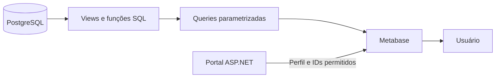

O PostgreSQL concentra os cálculos principais em views.

O Metabase utiliza essas estruturas para montar os cards, tabelas e gráficos.

O Portal define qual dashboard será exibido e quais identificadores o usuário pode acessar.

---

# Visão superior

As consultas da visão superior estão em:

```text
queries/superior/
```

## 1. Indicadores por consultor

Arquivo:

```text
queries/superior/01_kpi_consultores.sql
```

Apresenta os principais resultados de cada consultor:

- equipe;
- vendas;
- arrecadação;
- leads;
- conversão;
- atingimento da meta de vendas;
- atingimento da meta de arrecadação.

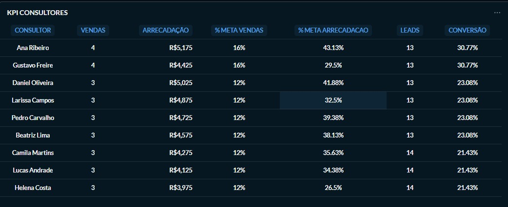

---

## 2. Indicadores por equipe

Arquivo:

```text
queries/superior/02_kpis_equipes.sql
```

Consolida os resultados das equipes:

- quantidade de vendas;
- arrecadação;
- leads;
- conversão;
- percentual das metas atingidas.

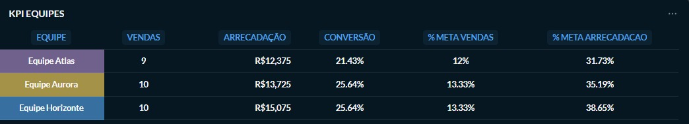

---

## 3. Tabela de conversão

Arquivo:

```text
queries/superior/03_conversao_vendas.sql
```

Compara o desempenho dos vendedores utilizando vendas, leads e taxa de conversão.

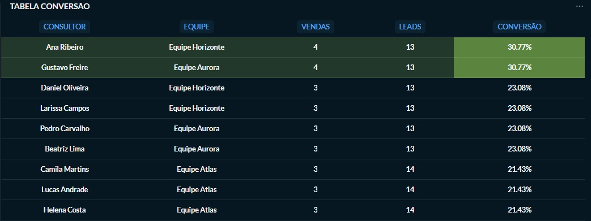

---

## 4. Vendas por dia

Arquivo:

```text
queries/superior/04_vendas_por_dia.sql
```

Apresenta a evolução diária de:

- quantidade de vendas;
- arrecadação.

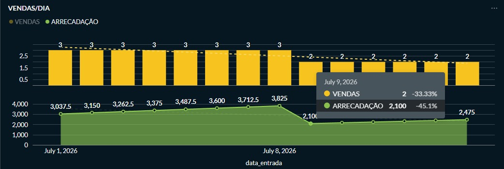

---

## 5. Indicadores gerais

Arquivo:

```text
queries/superior/05_kpi_geral.sql
```

Apresenta a visão consolidada da operação:

- vendas totais;
- arrecadação total;
- leads totais;
- conversão geral;
- projeção mensal.

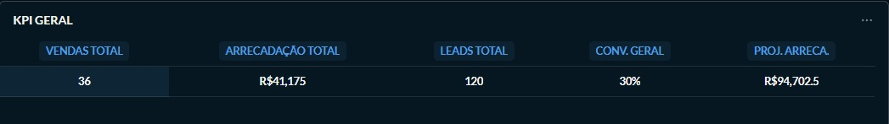

---

## 6. Vendas do dia atual

Arquivo:

```text
queries/superior/06_vendas_dia_atual.sql
```

Apresenta as vendas realizadas no dia, com informações como:

- vendedor;
- equipe;
- valor;
- forma de pagamento;
- status.

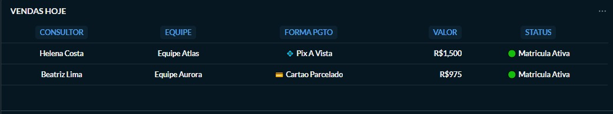

---

## 7. Ranking por pontos

Arquivo:

```text
queries/superior/07_rank_pontos_vendas.sql
```

Apresenta a classificação dos vendedores conforme as regras de pontuação definidas no projeto.

A pontuação considera fatores como:

- tipo de publicação;
- forma de pagamento;
- modalidade da venda.

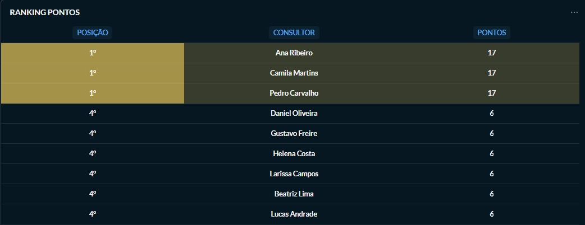

---

# Visão do vendedor

As consultas da visão individual estão em:

```text
queries/vendedor/
```

Elas utilizam os identificadores permitidos para restringir os dados ao usuário autenticado.

---

## 1. Indicadores do vendedor

Arquivo:

```text
queries/vendedor/01_kpi_consultor.sql
```

Apresenta:

- vendas;
- arrecadação;
- leads;
- conversão;
- percentual das metas atingidas.

---

## 2. Resumo de vendas do vendedor

Arquivo:

```text
queries/vendedor/02_vendas_consultor.sql
```

Apresenta informações específicas das vendas associadas ao usuário.

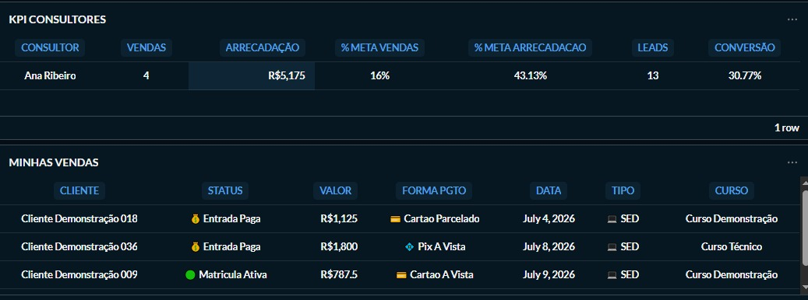

---

## 3. Conversão individual

Arquivo:

```text
queries/vendedor/03_tabela_conversao.sql
```

Apresenta a relação entre os leads recebidos e as vendas realizadas pelo vendedor.

---

## 4. Vendas por dia

Arquivo:

```text
queries/vendedor/04_vendas_dia.sql
```

Apresenta a evolução individual das vendas ao longo do período.

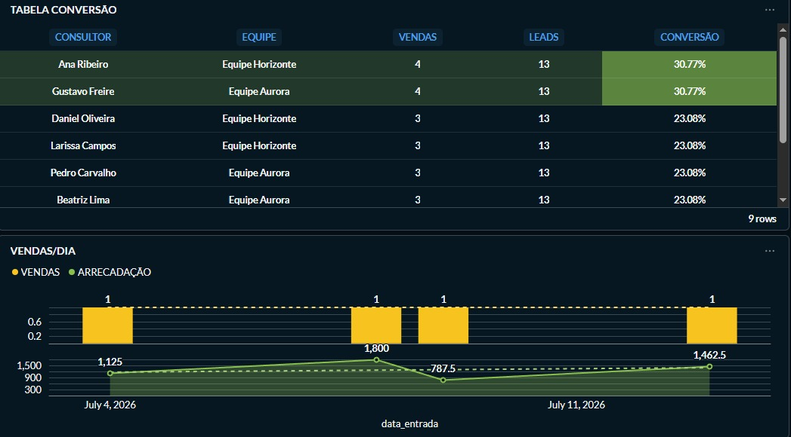

---

## 5. Vendas realizadas no dia

Arquivo:

```text
queries/vendedor/05_vendas_hoje.sql
```

Apresenta somente as vendas do usuário realizadas no dia atual.

---

## 6. Ranking

Arquivo:

```text
queries/vendedor/06_ranking_pontos.sql
```

Apresenta a posição e a pontuação do vendedor.

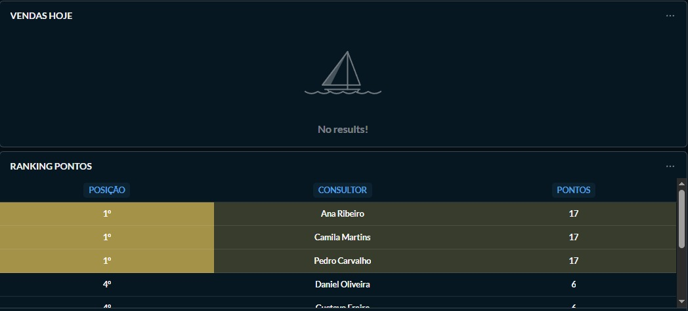

---

# Controle de acesso

O Metabase não define sozinho quais vendedores cada usuário pode consultar.

Essa responsabilidade pertence ao Portal e ao PostgreSQL.

O fluxo é:

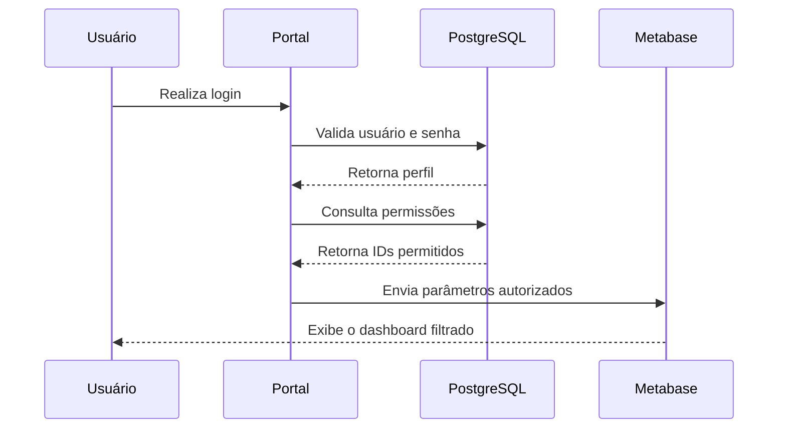

Os principais parâmetros utilizados são:

```text
ids_vendas
ids_leads
```

---

## Comportamento por perfil

| Perfil | Dados disponíveis |
|---|---|
| Vendedor | Somente os próprios IDs |
| Supervisor | Próprios IDs e IDs dos subordinados |
| Superior | Dashboard consolidado |

Os valores são obtidos pelo servidor e não escolhidos manualmente pelo usuário.

---

# Relação entre queries e views

As consultas utilizam principalmente as seguintes views:

```text
vendas_mes
leads_mes
vw_vendas_vendedor
vw_leads_vendedor
vw_vendas_equipes
vw_leads_equipes
vw_kpi_consultor
vw_kpi_geral
vw_tabela_conversao
vw_vendas_dias
vendas_dia_atual
kpi_equipes
ranking_mensal
```

Os nomes dessas views foram preservados no schema demonstrativo para manter a compatibilidade com as queries.

---

# Organização das queries

```text
queries/
├── superior/
│   ├── 01_kpi_consultores.sql
│   ├── 02_kpis_equipes.sql
│   ├── 03_conversao_vendas.sql
│   ├── 04_vendas_por_dia.sql
│   ├── 05_kpi_geral.sql
│   ├── 06_vendas_dia_atual.sql
│   └── 07_rank_pontos_vendas.sql
│
└── vendedor/
    ├── 01_kpi_consultor.sql
    ├── 02_vendas_consultor.sql
    ├── 03_tabela_conversao.sql
    ├── 04_vendas_dia.sql
    ├── 05_vendas_hoje.sql
    └── 06_ranking_pontos.sql
```

A numeração indica a ordem aproximada em que os cards são apresentados no dashboard.

---

# Recursos SQL demonstrados

As consultas demonstram o uso de:

- CTEs;
- agregações;
- `COUNT`;
- `SUM`;
- `FILTER`;
- `COALESCE`;
- `NULLIF`;
- `CASE`;
- cálculos percentuais;
- projeções;
- ordenação;
- rankings;
- joins;
- filtros parametrizados;
- tratamento de vendedores sem vendas ou leads.

---

# Dados demonstrativos

Os screenshots foram gerados utilizando o banco fictício disponível em:

```text
database/postgresql/
```

O ambiente demonstrativo possui:

- três equipes fictícias;
- vendedores fictícios;
- leads fictícios;
- vendas fictícias;
- metas fictícias.

Nenhum dado do ambiente original está presente nas imagens publicadas.

---

# Limitações do material publicado

O repositório não inclui:

- banco interno do Metabase;
- usuário administrador;
- senha;
- chave de embedding;
- URL da instância original;
- coleções internas;
- histórico de alterações;
- configurações de produção.

Os dashboards são apresentados por meio de:

- queries SQL;
- screenshots;
- documentação do fluxo;
- schema e seed demonstrativos.

---

# Estrutura da pasta

```text
metabase/
├── docs/
│   └── catalogo-dashboards.md
│
├── queries/
│   ├── superior/
│   └── vendedor/
│
├── screenshots/
│   ├── superior/
│   └── vendedor/
│
└── README.md
```

---

# Documentação relacionada

- [Catálogo dos dashboards](docs/catalogo-dashboards.md)
- [Arquitetura geral](../../docs/architecture/README.md)
- [Fluxo de autenticação](../../docs/architecture/fluxo-autenticacao.md)
- [Portal Web](../../apps/portal-web/README.md)
- [PostgreSQL](../../database/postgresql/README.md)
- [Automação n8n](../../automation/n8n/README.md)
- [Segurança](../../docs/security/README.md)