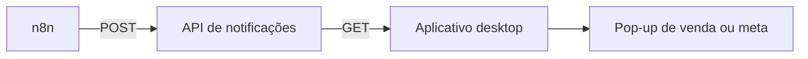

# API de Notificações

API ASP.NET responsável por receber eventos de vendas e metas enviados pelas automações e disponibilizar a notificação mais recente para o aplicativo desktop.

A aplicação mantém separadas as responsabilidades de automação, processamento e exibição dos avisos.

---

## Objetivo

Quando uma venda atende aos critérios definidos nos workflows, o n8n envia um evento para a API.

O aplicativo desktop consulta a API periodicamente e verifica se existe uma notificação diferente da última já exibida.

O fluxo é:



---

## Responsabilidades

A API é responsável por:

- receber eventos de venda;
- receber eventos de meta;
- validar o token do remetente;
- validar o conteúdo básico da requisição;
- armazenar o último evento processado;
- devolver a última notificação;
- validar o token do cliente;
- aplicar CORS conforme a configuração do ambiente.

---

## Endpoints

### Receber uma notificação

```http
POST /api/venda
```

Header esperado:

```http
X-Webhook-Token: SEU_TOKEN
Content-Type: application/json
```

Exemplo de corpo:

```json
{
  "idVenda": "demo-1001",
  "vendedor": "Lucas Andrade",
  "equipe": "Equipe Atlas",
  "valor": 850.00,
  "formaPagamento": "Pix à vista",
  "statusMatricula": "Matrícula ativa",
  "tipoPublicacao": "Diário Oficial",
  "dataVenda": "2026-07-01T10:30:00-03:00",
  "bateuMeta": false,
  "tipoMeta": null,
  "metaValor": null,
  "valorAtualMeta": null
}
```

A API valida o token recebido antes de aceitar o evento.

---

### Consultar a última notificação

```http
GET /api/vendas/ultima
```

Header esperado:

```http
X-Client-Token: SEU_TOKEN
```

Exemplo de resposta:

```json
{
  "temVenda": true,
  "venda": {
    "idVenda": "demo-1001",
    "vendedor": "Lucas Andrade",
    "equipe": "Equipe Atlas",
    "valor": 850.00,
    "formaPagamento": "Pix à vista",
    "statusMatricula": "Matrícula ativa",
    "tipoPublicacao": "Diário Oficial",
    "dataVenda": "2026-07-01T10:30:00-03:00",
    "bateuMeta": false
  }
}
```

Quando não há evento disponível, a API devolve uma resposta compatível com o estado sem nova venda.

---

## Tipos de evento

### Venda

Evento padrão contendo:

- identificador da venda;
- vendedor;
- equipe;
- valor;
- forma de pagamento;
- status;
- tipo de publicação;
- data da venda.

### Meta

O mesmo evento pode indicar que uma meta foi atingida.

Campos relacionados:

```text
bateuMeta
tipoMeta
metaValor
valorAtualMeta
```

Exemplos de tipo de meta:

```text
VENDAS
ARRECADACAO
```

---

## Autenticação por token

A API utiliza dois tokens com finalidades diferentes.

### Token do webhook

Utilizado pelo n8n para enviar notificações:

```text
X-Webhook-Token
```

### Token do cliente

Utilizado pelo aplicativo desktop para consultar a API:

```text
X-Client-Token
```

A separação permite que o cliente de consulta não tenha o mesmo nível de acesso de quem envia os eventos.

---

## Estrutura do projeto

```text
notificador-api/
├── examples/
│   └── venda-demo.json
│
├── Properties/
│   └── launchSettings.json
│
├── appsettings.example.json
├── NotificadorVendasApi.csproj
├── Program.cs
└── README.md
```

A implementação foi mantida compacta, com as rotas e configurações principais em `Program.cs`.

---

## Exemplo de requisição

O arquivo:

```text
examples/venda-demo.json
```

contém um evento fictício que pode ser utilizado para compreender o formato esperado pela API.

Exemplo com PowerShell:

```powershell
$headers = @{
    "X-Webhook-Token" = "CHANGE_ME"
}

$body = Get-Content `
    ".\examples\venda-demo.json" `
    -Raw

Invoke-RestMethod `
    -Uri "http://127.0.0.1:5000/api/venda" `
    -Method Post `
    -Headers $headers `
    -ContentType "application/json" `
    -Body $body
```

---

## Configuração

O arquivo publicado é:

```text
appsettings.example.json
```

Estrutura esperada:

```json
{
  "WebhookToken": "CHANGE_ME",
  "ClientToken": "CHANGE_ME",
  "AllowedOrigins": [
    "http://127.0.0.1:5001"
  ]
}
```

Dependendo da implementação, os valores também podem ser fornecidos por variáveis de ambiente:

```text
WEBHOOK_TOKEN
CLIENT_TOKEN
```

O arquivo real de configuração não é publicado.

---

## Segurança

A versão publicada não contém:

- token real do n8n;
- token real do aplicativo;
- endereço da API de produção;
- domínio;
- IP de servidor;
- dados de vendas reais;
- logs do ambiente original.

Os tokens devem ser fornecidos por configuração externa.

---

## Execução local

Na pasta do projeto:

```powershell
dotnet restore
dotnet run
```

A URL local é informada no terminal.

Exemplo:

```text
http://127.0.0.1:5000
```

A execução completa não é obrigatória para avaliação do projeto. O código e o exemplo de payload demonstram o contrato utilizado entre n8n, API e aplicativo desktop.

---

## Documentação relacionada

- [Automação n8n](../../automation/n8n/README.md)
- [Aplicativo desktop](../notificador-desktop/README.md)
- [Arquitetura](../../docs/architecture/README.md)
- [Segurança](../../docs/security/README.md)