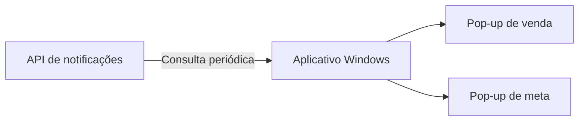

# Aplicativo Desktop de Notificações

Aplicação Windows Forms responsável por consultar a API e exibir avisos de vendas e metas nos computadores dos usuários.

O aplicativo foi desenvolvido para permitir que as notificações apareçam sem depender de uma página aberta no navegador.

---

## Objetivo

A aplicação consulta periodicamente o endpoint:

```http
GET /api/vendas/ultima
```

Quando encontra um evento com identificador diferente do último já exibido, apresenta um pop-up.

O fluxo é:



---

## Tipos de notificação

### Venda

O pop-up de venda apresenta:

- vendedor;
- equipe;
- valor;
- forma de pagamento;
- status da matrícula;
- tipo de publicação.

### Meta atingida

O pop-up de meta apresenta:

- vendedor;
- equipe;
- tipo de meta;
- valor atual;
- valor esperado;
- mensagem de destaque;
- elementos visuais específicos.

---

## Controle de duplicidade

A aplicação mantém o identificador do último evento já exibido.

Ao consultar a API:

1. verifica se existe uma notificação;
2. compara o ID recebido com o último ID processado;
3. ignora eventos repetidos;
4. exibe apenas eventos novos;
5. atualiza o estado local.

Esse comportamento evita que a mesma venda seja apresentada a cada consulta.

---

## Temas por equipe

O visual do pop-up pode variar conforme a equipe.

Na versão demonstrativa são utilizadas:

- Equipe Atlas;
- Equipe Aurora;
- Equipe Horizonte;
- tema padrão.

A classe responsável pelo tema é:

```text
TemaEquipe.cs
```

Ela define elementos como:

- cores;
- logos;
- imagens;
- estilo do pop-up.

---

## Estrutura do projeto

```text
notificador-desktop/
├── Assets/
│   ├── deal.png
│   ├── logo-equipe-atlas.png
│   ├── logo-equipe-aurora.jpg
│   ├── logo-equipe-horizonte.png
│   ├── logo-padrao.jpg
│   └── target.png
│
├── Models/
│   ├── EstadoNotificador.cs
│   ├── UltimaVendaResponse.cs
│   └── VendaDto.cs
│
├── scripts/
│   └── atualizar-exemplo.bat
│
├── Sounds/
│   └── alerta-venda.wav
│
├── ConfiguracaoAplicativo.cs
├── Form1.cs
├── Form1.Designer.cs
├── MetaBatidaForm.cs
├── PopupVendasForm.cs
├── Program.cs
├── SmoothPictureBox.cs
├── TemaEquipe.cs
├── appsettings.example.json
└── NotificadorVendasSoftware.csproj
```

---

## Principais arquivos

### `Form1.cs`

Responsável pelo funcionamento principal do aplicativo:

- inicialização;
- consulta periódica;
- comunicação com a API;
- controle do último evento;
- decisão entre venda e meta;
- abertura dos formulários.

### `PopupVendasForm.cs`

Responsável pela janela de nova venda.

Apresenta as informações comerciais e aplica o tema da equipe.

### `MetaBatidaForm.cs`

Responsável pela janela de meta atingida.

Apresenta os valores da meta e os elementos visuais de destaque.

### `ConfiguracaoAplicativo.cs`

Representa as configurações necessárias para acessar a API.

### `VendaDto.cs`

Representa o conteúdo de uma venda ou meta recebido da API.

### `EstadoNotificador.cs`

Mantém o estado utilizado para evitar a repetição de notificações.

### `TemaEquipe.cs`

Define cores, imagens e identidade visual conforme a equipe.

---

## Comunicação com a API

A aplicação utiliza:

```text
ApiBaseUrl
ClientToken
IntervaloSegundos
```

Exemplo de configuração:

```json
{
  "ApiBaseUrl": "http://127.0.0.1:5000",
  "ClientToken": "CHANGE_ME",
  "IntervaloSegundos": 5
}
```

O token é enviado no header:

```http
X-Client-Token
```

---

## Recursos implementados

- aplicação Windows Forms;
- consulta automática à API;
- controle de notificações repetidas;
- temas por equipe;
- pop-up de venda;
- pop-up de meta;
- carregamento de imagens;
- reprodução de alerta sonoro;
- janela com cantos personalizados;
- tratamento de configurações ausentes;
- tratamento de falhas de conexão;
- execução minimizada;
- suporte a atualização por script.

---

## Atualização do aplicativo

A pasta:

```text
scripts/
```

contém um exemplo de script utilizado para atualizar os arquivos do aplicativo.

O script demonstrativo pode:

1. encerrar a aplicação;
2. validar a pasta de origem;
3. copiar os arquivos atualizados;
4. substituir a versão local;
5. iniciar novamente o aplicativo.

Os caminhos reais utilizados no ambiente original foram removidos.

---

## Assets

Os arquivos visuais presentes em `Assets` são demonstrativos.

Eles representam:

- logos fictícios das equipes;
- imagem padrão;
- ícone de venda;
- ícone de meta.

Nenhum material da organização original deve permanecer nesta pasta.

---

## Configuração

O arquivo publicado é:

```text
appsettings.example.json
```

Para execução local, deve ser copiado como:

```text
appsettings.json
```

Depois, os valores devem ser preenchidos com uma API válida.

O arquivo real não é versionado nem incluído no pacote do portfólio.

---

## Execução local

Na pasta do projeto:

```powershell
dotnet restore
dotnet run
```

O projeto utiliza Windows Forms e deve ser executado no Windows.

A execução completa depende da API de notificações estar disponível.

---

## Segurança

A versão publicada não contém:

- URL real da API;
- token real do cliente;
- caminhos de rede internos;
- IPs empresariais;
- nomes reais de equipes;
- logos da organização;
- dados de vendas reais;
- arquivos compilados.

---

## Documentação relacionada

- [API de notificações](../notificador-api/README.md)
- [Automação n8n](../../automation/n8n/README.md)
- [Arquitetura](../../docs/architecture/README.md)
- [Segurança](../../docs/security/README.md)