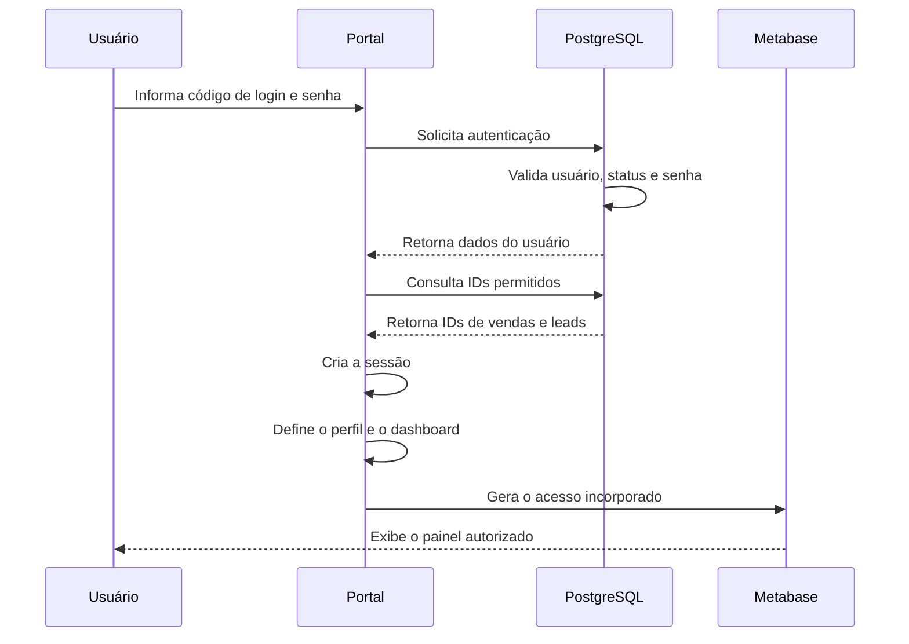
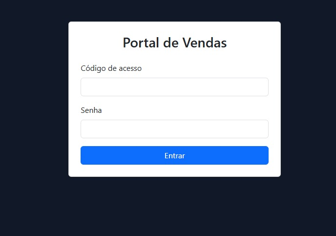
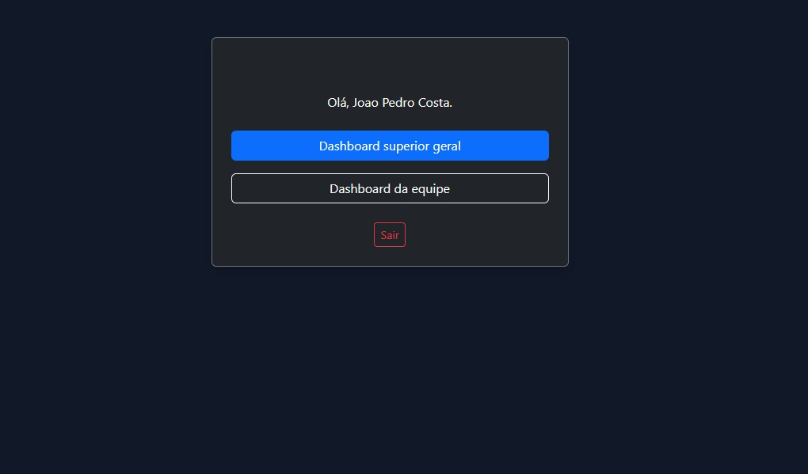

# Portal Web

Aplicação ASP.NET responsável pela autenticação dos usuários, classificação dos perfis de acesso e disponibilização dos dashboards incorporados do Metabase.

O portal funciona como uma camada intermediária entre o usuário, o PostgreSQL e o ambiente de Business Intelligence.

---

## Objetivo

O Metabase possui diferentes painéis e parâmetros de filtragem. O portal foi desenvolvido para evitar que os usuários precisassem acessar diretamente a ferramenta de BI ou informar manualmente seus identificadores.

A aplicação centraliza:

- login;
- validação de senha;
- primeiro acesso;
- sessão do usuário;
- identificação do perfil;
- consulta das permissões;
- escolha do dashboard;
- incorporação do painel do Metabase.

---

## Fluxo de autenticação



A senha não é consultada diretamente pelo portal. A validação acontece no PostgreSQL por meio da função:

```text
autenticar_usuario_portal
```

O banco compara a senha informada com o hash armazenado e devolve somente os dados necessários para criar a sessão.

---

## Perfis de acesso

A aplicação trabalha com três perfis.

### Vendedor

O vendedor recebe somente os identificadores associados ao próprio usuário.

A visualização inclui:

- vendas próprias;
- arrecadação;
- leads;
- conversão;
- metas;
- vendas por dia;
- posição no ranking.

### Supervisor

O supervisor recebe:

- os próprios identificadores;
- os identificadores dos vendedores vinculados a ele.

Dessa forma, consegue acompanhar sua equipe sem acessar outras equipes.

### Superior

O perfil superior possui acesso ao dashboard consolidado.

Essa visão inclui:

- todas as equipes;
- todos os vendedores;
- indicadores gerais;
- ranking;
- metas;
- projeções;
- comparações de desempenho.

---

## Controle de permissões

Após a autenticação, o portal consulta a função:

```text
obter_permissoes_metabase
```

Ela devolve dois grupos de identificadores:

```text
ids_vendas
ids_leads
```

Esses valores são utilizados como parâmetros das consultas do Metabase.

Exemplo demonstrativo:

```text
ids_vendas = {9111}
ids_leads  = {19111}
```

O usuário não escolhe manualmente esses valores. As permissões são obtidas pelo servidor a partir da sessão autenticada.

---

## Primeiro acesso

Usuários marcados com primeiro acesso precisam cadastrar uma nova senha antes de entrar no dashboard.

A alteração é processada pela função:

```text
alterar_senha_primeiro_acesso
```

A função:

1. valida o tamanho da nova senha;
2. gera um novo hash;
3. atualiza o usuário;
4. remove a indicação de primeiro acesso;
5. registra a data da alteração.

---

## Integração com o Metabase

O serviço responsável pela incorporação do dashboard está em:

```text
Services/MetabaseEmbedService.cs
```

A aplicação define o painel conforme o perfil do usuário e prepara os parâmetros autorizados.

O acesso ao Metabase utiliza configurações como:

```text
Metabase:BaseUrl
Metabase:EmbeddingSecret
Metabase:DashboardSuperiorId
Metabase:DashboardEquipeId
Metabase:DashboardVendedorId
```

Os valores reais não estão incluídos no repositório.

---

## Estrutura principal

```text
portal-web/
├── Controllers/
│   ├── ContaController.cs
│   └── HomeController.cs
│
├── Models/
│   ├── LoginViewModel.cs
│   ├── PrimeiroAcessoViewModel.cs
│   └── UsuarioPortal.cs
│
├── Services/
│   ├── AutenticacaoService.cs
│   └── MetabaseEmbedService.cs
│
├── Views/
│   ├── Conta/
│   ├── Home/
│   └── Shared/
│
├── screenshots/
├── wwwroot/
├── appsettings.example.json
├── PortalVendas.csproj
└── Program.cs
```

---

## Responsabilidades das principais classes

### `ContaController`

Responsável por:

- exibir a tela de login;
- processar a autenticação;
- controlar o primeiro acesso;
- encerrar a sessão;
- redirecionar acessos inválidos.

### `HomeController`

Responsável por:

- validar a sessão;
- selecionar o dashboard;
- preparar os dados da página;
- direcionar o vendedor, supervisor ou superior.

### `AutenticacaoService`

Responsável por:

- consultar o PostgreSQL;
- chamar as funções de autenticação;
- carregar o perfil do usuário;
- obter os identificadores permitidos.

### `MetabaseEmbedService`

Responsável por:

- selecionar o dashboard;
- preparar os parâmetros;
- gerar o acesso incorporado ao Metabase.

---

## Screenshots

### Tela de login



### Escolha de painel para acesso superior



---

## Configuração

O arquivo publicado é:

```text
appsettings.example.json
```

Ele contém somente valores demonstrativos.

Exemplo de estrutura:

```json
{
  "ConnectionStrings": {
    "Postgres": "Host=127.0.0.1;Port=5432;Database=ecossistema_portfolio;Username=portal_portfolio_app;Password=CHANGE_ME"
  },
  "Metabase": {
    "BaseUrl": "http://127.0.0.1:3001",
    "EmbeddingSecret": "CHANGE_ME",
    "DashboardSuperiorId": 1,
    "DashboardEquipeId": 2,
    "DashboardVendedorId": 3
  }
}
```

O arquivo real `appsettings.json` não faz parte do repositório.

---

## Segurança

A aplicação foi organizada para que:

- o hash da senha não seja devolvido ao navegador;
- os IDs autorizados sejam definidos pelo servidor;
- a sessão seja criada somente após uma autenticação válida;
- usuários inativos não consigam entrar;
- o perfil seja definido a partir dos dados do banco;
- a chave de incorporação do Metabase não fique no código-fonte;
- as credenciais sejam fornecidas por configuração externa.

---

## Execução local

A execução completa depende de:

- PostgreSQL;
- schema demonstrativo;
- seed demonstrativa;
- Metabase configurado;
- arquivo local de configuração.

Com o ambiente preparado:

```powershell
dotnet restore
dotnet run
```

A execução não é necessária para avaliar o projeto. O código, a documentação e os screenshots demonstram o funcionamento da aplicação.

---

## Documentação relacionada

- [Arquitetura geral](../../docs/architecture/README.md)
- [Fluxo de autenticação](../../docs/architecture/fluxo-autenticacao.md)
- [PostgreSQL](../../database/postgresql/README.md)
- [Dashboards](../../analytics/metabase/README.md)
- [Segurança](../../docs/security/README.md)