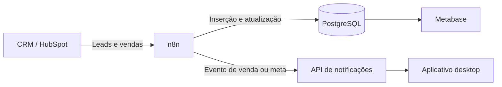
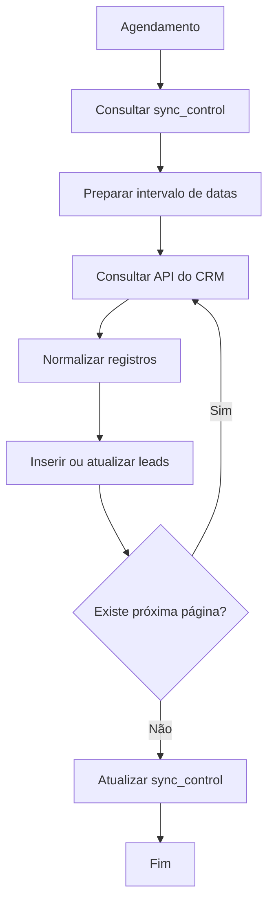
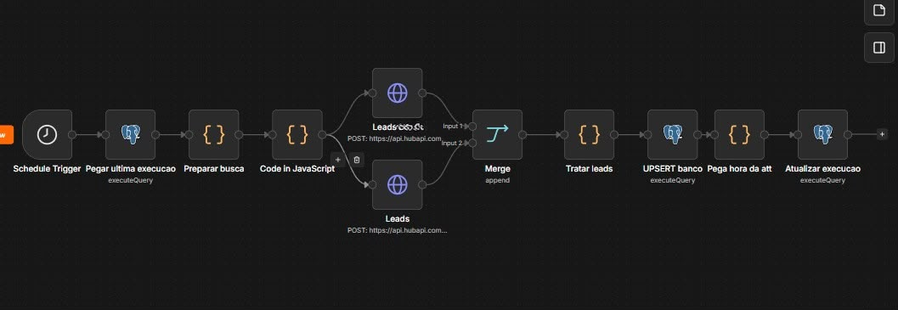
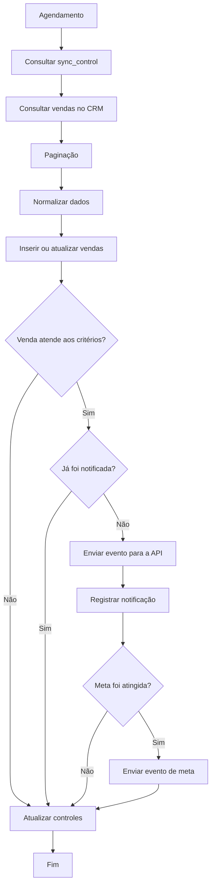
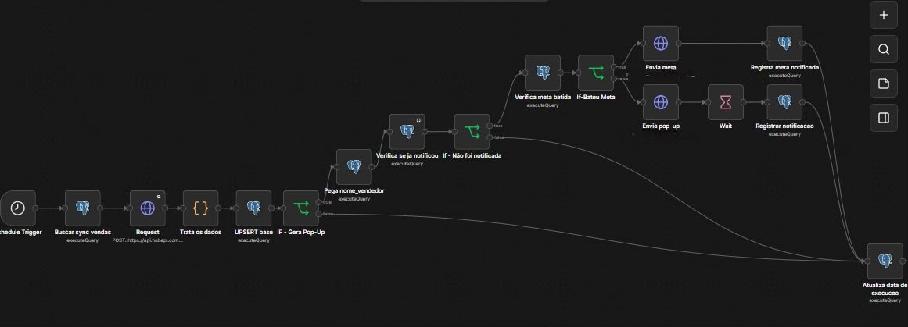

# Automações com n8n

Esta pasta contém versões sanitizadas dos workflows utilizados para integrar o CRM, o PostgreSQL e a API de notificações.

As automações foram responsáveis por substituir processos manuais de consulta, exportação e atualização de dados por sincronizações programadas.

---

## Objetivo

Os workflows realizam duas rotinas principais:

1. sincronização de leads;
2. sincronização de vendas e envio de notificações.

Os dados são consultados no CRM, tratados no n8n e armazenados no PostgreSQL.

Quando uma venda atende às regras configuradas, o workflow também envia um evento para a API de notificações.

---

## Visão geral



---

## Workflows publicados

| Arquivo | Responsabilidade |
|---|---|
| `sync_leads.json` | Consulta, tratamento e armazenamento de leads |
| `sync_vendas_e_notificacao.json` | Consulta de vendas, atualização do banco e envio de notificações |

Os arquivos estão disponíveis em:

```text
workflows/
```

As credenciais, URLs privadas, tokens e dados reais foram removidos.

---

# Sincronização de leads

O workflow de leads consulta os registros atribuídos no período atual e atualiza a tabela correspondente no PostgreSQL.

Arquivo:

```text
workflows/sync_leads.json
```

## Fluxo



## Etapas principais

### 1. Leitura do controle de sincronização

Antes de consultar o CRM, o workflow busca na tabela:

```text
sync_control
```

o horário da última execução concluída.

Esse valor é utilizado para limitar a próxima busca.

### 2. Preparação do período

O workflow monta os filtros de data necessários para consultar:

- registros atribuídos no mês atual;
- registros modificados depois da última execução;
- registros modificados até o início da execução atual.

### 3. Paginação

A API devolve os registros em páginas.

O workflow controla o campo de paginação e continua consultando enquanto existir uma próxima página.

O limite utilizado no ambiente demonstrativo é:

```text
200 registros por página
```

### 4. Normalização

Os registros recebidos são ajustados antes do envio ao banco.

Entre os tratamentos estão:

- conversão de datas;
- tratamento de campos vazios;
- normalização de identificadores;
- definição do proprietário;
- padronização de textos;
- validação dos registros obrigatórios.

### 5. Inserção ou atualização

O PostgreSQL recebe os registros por meio de uma operação compatível com atualização incremental.

Quando o lead já existe, seus dados são atualizados.

Quando ainda não existe, um novo registro é criado.

### 6. Atualização do controle

A tabela `sync_control` só é atualizada após a conclusão das etapas principais.

Isso evita registrar uma execução como concluída antes que os dados tenham sido processados.

---

## Screenshot do workflow de leads



---

# Sincronização de vendas e notificações

O segundo workflow consulta vendas, atualiza o PostgreSQL e verifica se o registro deve gerar uma notificação.

Arquivo:

```text
workflows/sync_vendas_e_notificacao.json
```

## Fluxo



## Etapas principais

### 1. Consulta incremental

Assim como no fluxo de leads, o workflow utiliza a tabela `sync_control` para consultar apenas registros novos ou modificados.

### 2. Filtros comerciais

A consulta considera regras como:

- período da venda;
- status da matrícula;
- equipe;
- data de modificação;
- campos necessários para os indicadores.

### 3. Normalização

Antes da gravação, são tratados:

- valor da entrada;
- forma de pagamento;
- status;
- equipe;
- proprietário;
- data da venda;
- categoria;
- tipo de publicação.

### 4. Atualização do PostgreSQL

As vendas são inseridas ou atualizadas na tabela principal.

Esse processo mantém os dashboards atualizados sem precisar recriar toda a base.

### 5. Validação da notificação

Depois da atualização, o workflow verifica se a venda atende às condições necessárias para gerar um aviso.

Entre os critérios utilizados estão:

- status válido;
- venda realizada no dia;
- equipe habilitada;
- dados mínimos preenchidos.

### 6. Controle de duplicidade

Antes de enviar uma notificação, o workflow consulta a tabela:

```text
vendas_notificadas
```

Se a venda já estiver registrada, o evento não é enviado novamente.

Após o envio, o identificador é salvo para impedir duplicidades em execuções futuras.

### 7. Notificação de metas

O mesmo workflow pode verificar o atingimento de metas.

O controle é realizado pela tabela:

```text
metas_notificadas
```

Ela impede que a mesma meta seja anunciada várias vezes dentro do mesmo período.

### 8. Envio para a API

Quando o evento é válido, o n8n envia uma requisição HTTP para:

```http
POST /api/venda
```

O payload pode representar uma venda comum ou uma meta atingida.

---

## Screenshot do workflow de vendas e notificações



---

# Sincronização incremental

A sincronização incremental evita consultar toda a base do CRM a cada execução.

O processo utiliza três referências de tempo:

```text
início do período analisado
última execução concluída
horário atual da execução
```

A lógica simplificada é:

```text
lastmodifieddate >= última execução
lastmodifieddate <= horário atual
```

Ao final de uma execução bem-sucedida, o horário atual é salvo para servir de início da próxima consulta.

## Benefícios

- menor volume de dados processados;
- redução de chamadas à API;
- menor tempo de execução;
- atualização mais frequente;
- recuperação mais simples em caso de falha;
- prevenção de cargas completas desnecessárias.

---

# Paginação

A API do CRM limita a quantidade de registros devolvidos por requisição.

Os workflows verificam o valor de paginação retornado e continuam consultando até que não exista uma próxima página.

Fluxo simplificado:

```text
Primeira requisição
        ↓
Recebe registros e próximo cursor
        ↓
Executa nova requisição com o cursor
        ↓
Repete até não existir próxima página
```

A paginação permite processar volumes maiores sem ultrapassar o limite de uma única requisição.

---

# Tratamento de datas

Os workflows lidam com diferentes formatos de data:

- timestamps da API;
- datas ISO;
- timestamps em milissegundos;
- datas armazenadas no PostgreSQL;
- horário local da operação.

O fuso horário adotado na lógica demonstrativa é:

```text
America/Sao_Paulo
```

Os tratamentos evitam problemas como:

- considerar uma venda do dia anterior;
- registrar horários deslocados;
- repetir registros;
- deixar registros fora do intervalo incremental.

---

# Prevenção de duplicidades

A solução utiliza diferentes estratégias de controle:

| Situação | Controle |
|---|---|
| Lead já existente | Atualização pelo identificador |
| Venda já existente | Atualização pelo identificador |
| Venda já notificada | Tabela `vendas_notificadas` |
| Meta já notificada | Tabela `metas_notificadas` |
| Período já sincronizado | Tabela `sync_control` |

A combinação desses controles torna os workflows mais seguros para execuções recorrentes.

---

# Integrações utilizadas

## CRM

A origem dos dados é consultada por requisições HTTP.

No ambiente original, a integração utilizava a API de pesquisa de contatos do CRM.

## PostgreSQL

O banco recebe:

- leads;
- vendas;
- controle de sincronização;
- registros de notificações;
- controle das metas notificadas.

## API de notificações

O workflow envia eventos de venda e metas para uma API ASP.NET.

O token é configurado na credencial ou no header da requisição.

Nenhum token real está presente nos arquivos publicados.

---

# Estrutura da pasta

```text
n8n/
├── screenshots/
│   ├── 01-workflow-leads.jpeg
│   └── 02-workflow-vendas-e-notificacao.jpeg
│
├── workflows/
│   ├── sync_leads.json
│   └── sync_vendas_e_notificacao.json
│
└── README.md
```

---

# Importação dos workflows

Os arquivos JSON podem ser importados em uma instalação do n8n.

Após a importação, é necessário configurar novamente:

1. credencial da API do CRM;
2. credencial do PostgreSQL;
3. URL da API de notificações;
4. token do webhook;
5. identificadores das credenciais;
6. agendamentos;
7. variáveis específicas do ambiente.

Os workflows publicados devem permanecer desativados até que essas configurações sejam revisadas.

---

# Configurações removidas

Os arquivos publicados não incluem:

- tokens;
- senhas;
- IDs de credenciais;
- credenciais criptografadas;
- URLs privadas;
- IPs de servidores;
- dados fixados nos nodes;
- resultados de execuções;
- informações de clientes;
- dados reais de vendas ou leads.

Os valores privados foram substituídos por exemplos ou removidos.

---

# Pontos técnicos demonstrados

Os workflows demonstram experiência com:

- integração de APIs REST;
- autenticação por token;
- paginação;
- sincronização incremental;
- tratamento de datas;
- controle de fuso horário;
- transformação de dados com JavaScript;
- operações no PostgreSQL;
- prevenção de duplicidades;
- condições e ramificações;
- requisições HTTP;
- tratamento de valores nulos;
- automações recorrentes;
- integração entre serviços.

---

# Documentação relacionada

- [Arquitetura geral](../../docs/architecture/README.md)
- [PostgreSQL](../../database/postgresql/README.md)
- [API de notificações](../../apps/notificador-api/README.md)
- [Aplicativo desktop](../../apps/notificador-desktop/README.md)
- [Segurança](../../docs/security/README.md)