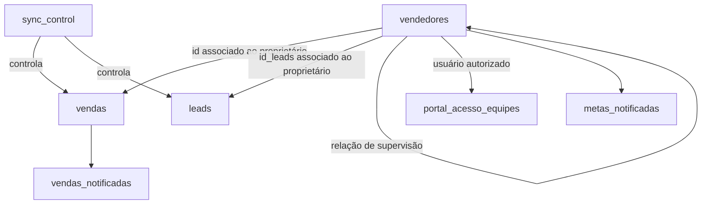

# PostgreSQL

O PostgreSQL funciona como camada central de dados do ecossistema comercial.

Ele recebe os registros sincronizados pelo n8n, mantém as informações utilizadas pelos dashboards, aplica regras de autenticação e controla eventos que não podem ser processados mais de uma vez.

O material desta pasta utiliza somente dados fictícios.

---

## Responsabilidades

O banco de dados concentra:

- vendas;
- leads;
- vendedores;
- equipes;
- metas;
- permissões de acesso;
- calendário e dias úteis;
- controle de sincronização;
- controle de vendas notificadas;
- controle de metas notificadas;
- funções de autenticação;
- views utilizadas pelo Metabase.

---

## Estrutura da pasta

```text
postgresql/
├── docs/
│   ├── estrutura-tabelas-principais.sql
│   └── inventario-banco.txt
│
├── schema/
│   └── 01_schema_portfolio.sql
│
├── seeds/
│   └── 02_seed_demo.sql
│
├── tests/
│   └── 03_validacao_demo.sql
│
└── README.md
```

### `schema/`

Contém a estrutura do banco:

- tabelas;
- sequences;
- constraints;
- índices;
- relacionamentos;
- views;
- funções.

### `seeds/`

Contém dados fictícios compatíveis com as regras e consultas do projeto.

### `tests/`

Contém consultas de validação para conferir se a estrutura e os dados demonstrativos foram carregados corretamente.

### `docs/`

Contém materiais auxiliares sobre a estrutura do banco.

---

# Estrutura principal

## Tabelas operacionais

### `vendas`

Armazena os registros comerciais utilizados nos indicadores.

Principais campos:

| Campo | Finalidade |
|---|---|
| `id` | Identificador da venda |
| `nome` | Nome fictício associado ao registro |
| `proprietario_contato` | Identificador do vendedor responsável |
| `equipe` | Equipe comercial |
| `stts_matricula` | Situação da matrícula |
| `valor_entrada` | Valor recebido na entrada |
| `forma_pgto` | Forma de pagamento |
| `data_entrada` | Data e horário da venda |
| `origem` | Origem comercial |
| `tipo_publi` | Tipo de publicação |
| `curso_ofertado` | Categoria ou curso associado |

---

### `leads`

Armazena os leads atribuídos aos vendedores.

Principais campos:

| Campo | Finalidade |
|---|---|
| `id` | Identificador do lead |
| `nome` | Nome fictício |
| `numero1` | Telefone demonstrativo |
| `numero2` | Telefone alternativo demonstrativo |
| `qualificacao` | Classificação do lead |
| `origem` | Origem do contato |
| `proprietario_contato` | Identificador do responsável |
| `data_atribuicao` | Data de atribuição |

Os números presentes na seed são fictícios e não representam pessoas reais.

---

### `vendedores`

Centraliza vendedores, supervisores, metas e informações utilizadas pelo Portal.

Principais campos:

| Campo | Finalidade |
|---|---|
| `id` | Identificador utilizado nas vendas |
| `id_leads` | Identificador utilizado nos leads |
| `nome_vendedor` | Nome fictício do usuário |
| `equipe` | Equipe comercial |
| `meta_vendas` | Meta mensal de quantidade |
| `meta_arrecadacao` | Meta mensal de arrecadação |
| `codigo_login` | Código utilizado no Portal |
| `senha_hash` | Hash da senha |
| `supervisor` | Identificador do supervisor |
| `status` | Situação do usuário |
| `acesso_superior` | Indicação de acesso consolidado |
| `primeiro_acesso` | Indicação de troca inicial de senha |
| `senha_alterada_em` | Data da última alteração de senha |

O campo `supervisor` estabelece uma relação da tabela `vendedores` com ela mesma.

---

## Tabelas de controle

### `sync_control`

Registra a última execução concluída de cada workflow.

Principais campos:

```text
workflow_name
last_success_at
updated_at
```

Essa tabela permite que as automações consultem somente registros novos ou modificados.

---

### `vendas_notificadas`

Registra vendas que já geraram notificação.

O controle evita que a mesma venda seja enviada várias vezes para a API.

---

### `metas_notificadas`

Registra metas que já foram anunciadas.

A combinação abaixo impede notificações repetidas no mesmo período:

```text
vendedor
tipo_meta
mes_referencia
```

---

### `portal_acesso_equipes`

Registra permissões adicionais de acesso por equipe.

Essa tabela é utilizada quando um usuário superior acessa uma visão específica de equipe.

---

### `feriado`

Armazena datas que não devem ser consideradas como dias úteis.

Ela é utilizada em conjunto com as views de calendário e projeção mensal.

---

## Tabelas temporárias

### `exp_temp_leads`

Estrutura auxiliar para operações temporárias ou importações de leads.

### `exp_temp_vendas`

Estrutura auxiliar para operações temporárias ou importações de vendas.

Essas tabelas não são a origem principal dos dashboards.

---

# Relações principais



A associação de vendas e leads com vendedores considera identificadores provenientes de sistemas externos. Por isso, parte dessa ligação é tratada nas views e não exclusivamente por foreign keys.

---

# Views

As views transformam os dados operacionais em informações adequadas para dashboards e aplicações.

Os nomes foram preservados porque são utilizados pelas queries do Metabase.

## Views mensais

### `vendas_mes`

Seleciona as vendas válidas do mês atual e associa o proprietário ao vendedor correspondente.

Também aplica regras relacionadas a:

- período;
- status;
- identificação do vendedor;
- equipe;
- categoria.

### `leads_mes`

Seleciona os leads atribuídos no mês atual e associa o identificador do proprietário ao vendedor correspondente.

---

## Views por vendedor

### `vw_vendas_vendedor`

Consolida por consultor:

- quantidade de vendas;
- arrecadação;
- quantidade de vendas de categorias específicas.

### `vw_leads_vendedor`

Calcula a quantidade de leads atribuídos a cada consultor.

### `vw_kpi_consultor`

Consolida:

- vendas;
- arrecadação;
- leads;
- conversão;
- percentual da meta de vendas;
- percentual da meta de arrecadação.

### `vw_tabela_conversao`

Apresenta os resultados de conversão por vendedor em formato adequado para o dashboard.

---

## Views por equipe

### `vw_vendas_equipes`

Consolida vendas, arrecadação e metas por equipe.

### `vw_leads_equipes`

Consolida a quantidade de leads por equipe.

### `kpi_equipes`

Calcula por equipe:

- vendas;
- arrecadação;
- leads;
- conversão;
- atingimento da meta de vendas;
- atingimento da meta de arrecadação.

---

## Views gerais

### `vw_kpi_geral`

Apresenta os principais indicadores consolidados:

- total de vendas;
- total arrecadado;
- total de leads;
- conversão geral;
- projeção mensal.

### `vw_vendas_dias`

Agrupa vendas e arrecadação por dia.

### `vendas_dia_atual`

Apresenta as vendas realizadas no dia atual.

### `atribuidos_hoje`

Apresenta a quantidade de leads atribuídos no dia para cada vendedor.

### `ranking_mensal`

Calcula a pontuação mensal dos vendedores conforme as regras comerciais definidas no projeto.

---

## Views de calendário

### `vw_calendario`

Gera uma estrutura de calendário utilizada nos cálculos de período.

### `dias_uteis_mes`

Calcula:

- dias úteis totais;
- dias úteis passados;
- dias úteis restantes.

A view desconsidera finais de semana e datas presentes na tabela `feriado`.

---

## Views do Portal

### `vw_classificacao_portal`

Classifica os usuários como:

```text
VENDEDOR
SUPERVISOR
SUPERIOR
```

A classificação considera:

- acesso superior;
- relacionamento com subordinados;
- status do usuário.

### `vw_permissoes_dashboard`

Define quais identificadores de vendas e leads um usuário pode acessar.

Essa view é utilizada pelas funções de permissão do Portal.

---

# Funções

## `autenticar_usuario_portal`

Valida:

- código de login;
- status do usuário;
- senha informada;
- hash armazenado.

A função devolve somente os dados necessários para criar a sessão.

O campo `senha_hash` não é devolvido ao Portal.

---

## `alterar_senha_primeiro_acesso`

Permite que o usuário defina uma nova senha no primeiro acesso.

A função:

1. valida a nova senha;
2. gera o hash;
3. atualiza o usuário;
4. desmarca o primeiro acesso;
5. registra a data da alteração.

---

## `obter_permissoes_metabase`

Devolve os identificadores que o usuário pode utilizar nos dashboards.

O retorno possui:

```text
ids_vendas
ids_leads
```

A função possui uma versão básica e uma versão que recebe um modo de acesso.

---

# Segurança de senha

O schema utiliza a extensão:

```text
pgcrypto
```

A senha é armazenada com hash e validada pelo PostgreSQL.

Exemplo simplificado:

```sql
senha_hash = crypt(
    senha_informada,
    senha_hash
)
```

O objetivo é impedir o armazenamento de senhas em texto simples.

---

# Sincronização incremental

A tabela `sync_control` permite que cada workflow registre seu último processamento concluído.

Exemplo:

```text
sync_leads
sync_vendas
```

O fluxo utiliza:

```text
lastmodifieddate >= last_success_at
lastmodifieddate <= horario_atual
```

O controle só deve ser atualizado após a execução terminar com sucesso.

---

# Prevenção de duplicidades

O banco utiliza diferentes estratégias:

| Situação | Estratégia |
|---|---|
| Lead repetido | Identificador único |
| Venda repetida | Chave primária |
| Venda já notificada | `vendas_notificadas` |
| Meta já notificada | Restrição em `metas_notificadas` |
| Workflow já processado | `sync_control` |
| Login duplicado | Índice único no código de login |

---

# Dados demonstrativos

O arquivo:

```text
seeds/02_seed_demo.sql
```

cria um conjunto fictício compatível com as views e queries.

O resultado esperado é:

| Estrutura | Quantidade |
|---|---:|
| Vendedores e supervisores | 9 |
| Leads | 120 |
| Vendas | 36 |

As equipes demonstrativas são:

```text
Equipe Atlas
Equipe Aurora
Equipe Horizonte
```

Todos os nomes, identificadores, telefones e valores foram criados exclusivamente para demonstração.

---

# Ordem de execução

## 1. Criar ou selecionar o banco

Exemplo:

```sql
CREATE DATABASE ecossistema_portfolio;
```

## 2. Executar o schema

```powershell
psql `
    -h 127.0.0.1 `
    -p 5432 `
    -U postgres `
    -d ecossistema_portfolio `
    -v ON_ERROR_STOP=1 `
    -f ".\schema\01_schema_portfolio.sql"
```

## 3. Executar a seed

```powershell
psql `
    -h 127.0.0.1 `
    -p 5432 `
    -U postgres `
    -d ecossistema_portfolio `
    -v ON_ERROR_STOP=1 `
    -f ".\seeds\02_seed_demo.sql"
```

## 4. Executar as validações

```powershell
psql `
    -h 127.0.0.1 `
    -p 5432 `
    -U postgres `
    -d ecossistema_portfolio `
    -v ON_ERROR_STOP=1 `
    -f ".\tests\03_validacao_demo.sql"
```

Os comandos devem ser executados dentro da pasta:

```text
database/postgresql/
```

---

# Validação manual

Para conferir as quantidades:

```sql
SELECT
    (SELECT COUNT(*) FROM vendedores) AS vendedores,
    (SELECT COUNT(*) FROM leads) AS leads,
    (SELECT COUNT(*) FROM vendas) AS vendas;
```

Para conferir os indicadores gerais:

```sql
SELECT *
FROM vw_kpi_geral;
```

Para conferir os indicadores por vendedor:

```sql
SELECT *
FROM vw_kpi_consultor
ORDER BY equipe, consultor;
```

Para conferir as equipes:

```sql
SELECT *
FROM kpi_equipes
ORDER BY equipe;
```

Para conferir o ranking:

```sql
SELECT *
FROM ranking_mensal;
```

---

# Compatibilidade com o Metabase

As queries do Metabase utilizam principalmente:

```text
vendas_mes
leads_mes
vw_kpi_consultor
vw_kpi_geral
vw_tabela_conversao
vw_vendas_dias
vendas_dia_atual
kpi_equipes
ranking_mensal
```

Por isso, esses nomes devem ser preservados ao modificar o schema.

---

# Arquivos auxiliares

## `docs/estrutura-tabelas-principais.sql`

Consulta auxiliar para inspecionar a estrutura das principais tabelas.

## `docs/inventario-banco.txt`

Inventário demonstrativo da estrutura do banco.

Esse arquivo não deve conter:

- nome do servidor original;
- usuário real;
- IP;
- domínio;
- caminhos de backup;
- nomes empresariais;
- dados de produção.

---

# Segurança e sanitização

O material publicado não contém:

- dados de clientes;
- dados reais de vendas;
- telefones reais;
- nomes reais de vendedores;
- senha administrativa;
- string de conexão;
- usuário de produção;
- IP da VPS;
- backups;
- arquivo `pgdata`;
- dump de produção.

O schema e a seed foram preparados somente para demonstração técnica.

---

# Documentação relacionada

- [Arquitetura geral](../../docs/architecture/README.md)
- [Fluxo de autenticação](../../docs/architecture/fluxo-autenticacao.md)
- [Automação n8n](../../automation/n8n/README.md)
- [Dashboards do Metabase](../../analytics/metabase/README.md)
- [Portal web](../../apps/portal-web/README.md)
- [Segurança](../../docs/security/README.md)