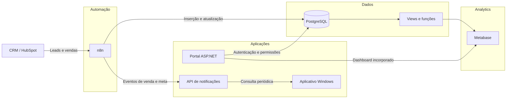
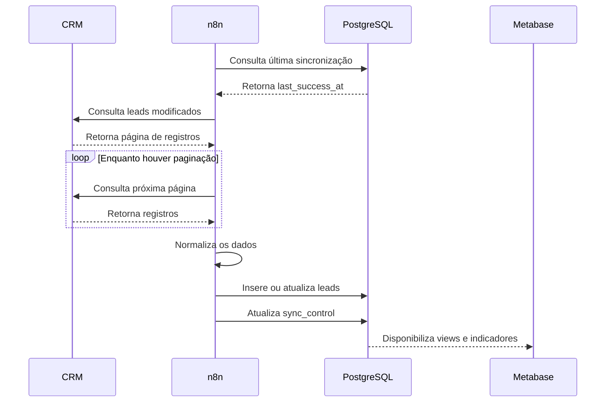
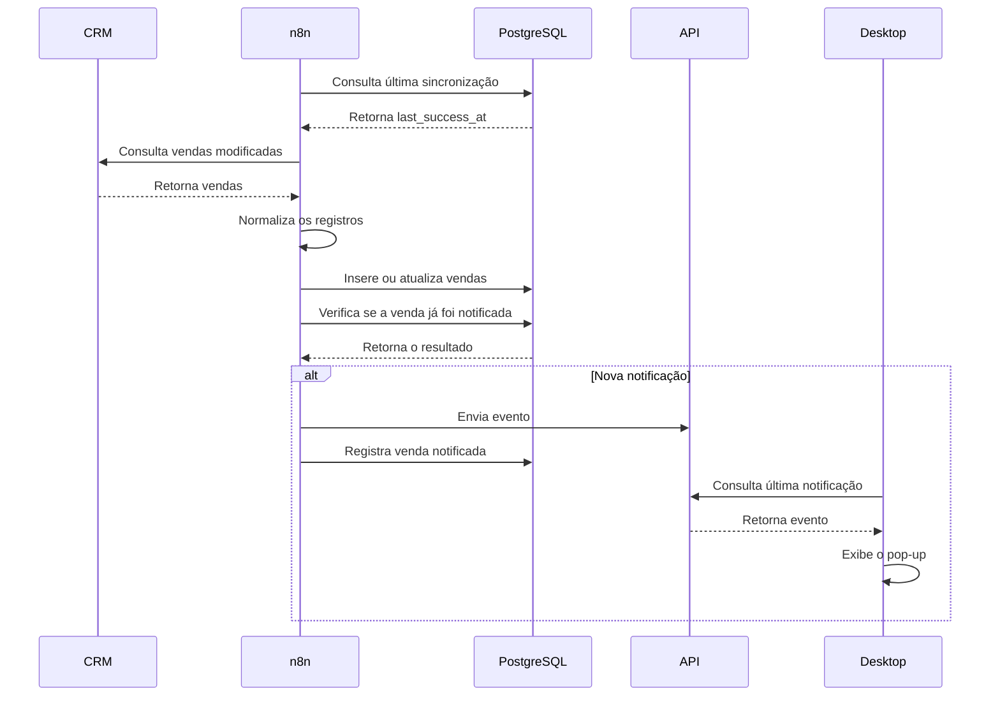

# Arquitetura do Ecossistema

O projeto foi estruturado como um conjunto de componentes independentes, integrados por APIs, banco de dados e automações.

A separação foi adotada para evitar que uma única aplicação concentrasse todas as responsabilidades.

---

## Visão geral



---

## Componentes

### CRM

Funciona como origem dos dados comerciais.

Os registros consultados incluem informações relacionadas a:

- leads;
- vendas;
- proprietário;
- status;
- forma de pagamento;
- datas;
- origem;
- categoria;
- tipo de publicação.

A versão pública do projeto não inclui credenciais ou dados do CRM.

---

### n8n

O n8n executa a camada de integração.

Principais responsabilidades:

- agendamento das rotinas;
- autenticação na API;
- paginação;
- sincronização incremental;
- normalização;
- validação;
- inserção e atualização no PostgreSQL;
- identificação de vendas notificáveis;
- envio de eventos para a API.

Os workflows estão em:

```text
automation/n8n/workflows/
```

---

### PostgreSQL

O PostgreSQL é a base central do sistema.

Ele armazena:

- vendas;
- leads;
- vendedores;
- metas;
- notificações;
- permissões;
- calendário;
- controle de sincronização.

Também concentra regras em:

- views;
- funções;
- constraints;
- índices.

As views fornecem uma camada estável para as queries do Metabase.

---

### Metabase

O Metabase apresenta os indicadores comerciais.

Os dashboards foram separados em:

- visão superior;
- visão do vendedor.

A visão superior consolida equipes e vendedores.

A visão individual utiliza identificadores autorizados para restringir os resultados.

---

### Portal ASP.NET

O Portal funciona como camada de autenticação e controle de acesso.

Responsabilidades:

- receber código de login e senha;
- solicitar a autenticação ao PostgreSQL;
- identificar o perfil;
- consultar os IDs autorizados;
- criar a sessão;
- selecionar o dashboard;
- preparar o acesso incorporado ao Metabase.

---

### API de notificações

A API recebe eventos enviados pelo n8n.

Os eventos podem representar:

- nova venda;
- meta de vendas atingida;
- meta de arrecadação atingida.

A API disponibiliza o último evento para clientes autorizados.

---

### Aplicativo Windows

O aplicativo desktop consulta a API em intervalos definidos.

Quando encontra uma notificação ainda não exibida, abre um pop-up.

O conteúdo pode variar conforme:

- tipo de evento;
- vendedor;
- equipe;
- meta;
- valor;
- forma de pagamento.

---

# Fluxo de dados

## Leads



---

## Vendas



---

# Sincronização incremental

As automações não consultam toda a base em cada execução.

A tabela:

```text
sync_control
```

registra o horário da última sincronização concluída.

A consulta seguinte utiliza um intervalo semelhante a:

```text
data de modificação >= última execução
data de modificação <= horário atual
```

O controle só é atualizado após a conclusão das etapas principais.

## Benefícios

- menor volume processado;
- menor quantidade de chamadas;
- execução mais rápida;
- possibilidade de sincronizações frequentes;
- recuperação mais segura em caso de falha.

---

# Camada de dados analíticos

As tabelas operacionais não são consultadas diretamente em todos os dashboards.

O PostgreSQL fornece views como:

```text
vendas_mes
leads_mes
vw_kpi_consultor
vw_kpi_geral
kpi_equipes
ranking_mensal
vw_vendas_dias
```

Essa camada reduz a repetição de regras entre diferentes queries.

Também evita que cada card precise reconstruir toda a lógica de associação e filtragem.

---

# Controle de acesso

O sistema possui três perfis:

| Perfil | Escopo |
|---|---|
| Vendedor | Próprios resultados |
| Supervisor | Próprios resultados e subordinados |
| Superior | Visão consolidada |

O Portal consulta o PostgreSQL para descobrir quais IDs podem ser utilizados pelo usuário.

Esses valores são enviados ao Metabase como parâmetros autorizados.

Mais detalhes:

[Fluxo de autenticação](fluxo-autenticacao.md)

---

# Notificações

A notificação foi mantida fora do Portal.

O fluxo utiliza:

```text
n8n
  ↓
API ASP.NET
  ↓
Aplicativo Windows
```

Essa divisão permite que:

- o Portal permaneça focado em autenticação e dashboards;
- o n8n continue responsável pelas regras;
- a API funcione como interface entre automação e clientes;
- o aplicativo desktop seja atualizado separadamente.

---

# Separação de responsabilidades

| Componente | Responsabilidade principal |
|---|---|
| CRM | Origem dos registros |
| n8n | Integração e automação |
| PostgreSQL | Persistência e regras |
| Metabase | Visualização |
| Portal | Autenticação e autorização |
| API | Distribuição das notificações |
| Desktop | Exibição dos avisos |

---

# Organização do repositório

```text
analytics/
    Queries e screenshots do Metabase.

apps/
    Portal, API e aplicativo desktop.

automation/
    Workflows do n8n.

database/
    Schema, seed e validações.

docs/
    Arquitetura, segurança e setup.

infrastructure/
    Exemplos de Docker e Nginx.
```

---

# Documentos relacionados

- [Fluxo de autenticação](fluxo-autenticacao.md)
- [Decisões técnicas](decisoes-tecnicas.md)
- [Automação n8n](../../automation/n8n/README.md)
- [PostgreSQL](../../database/postgresql/README.md)
- [Metabase](../../analytics/metabase/README.md)
- [Portal](../../apps/portal-web/README.md)
- [API](../../apps/notificador-api/README.md)
- [Aplicativo desktop](../../apps/notificador-desktop/README.md)