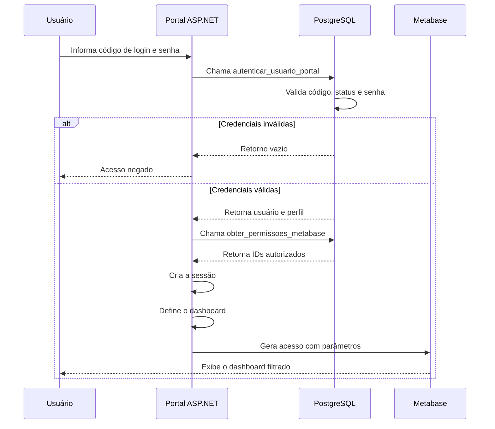

# Fluxo de Autenticação e Acesso aos Dashboards

O Portal utiliza o PostgreSQL para validar as credenciais e definir o escopo de dados permitido para cada usuário.

A aplicação não recebe o hash da senha para realizar a comparação em C#. A validação ocorre dentro do banco.

---

## Fluxo geral



---

# Cadastro do usuário

Os dados utilizados pelo Portal ficam na tabela:

```text
vendedores
```

Principais campos:

| Campo | Utilização |
|---|---|
| `id` | Identificador utilizado nas vendas |
| `id_leads` | Identificador utilizado nos leads |
| `codigo_login` | Código utilizado no login |
| `senha_hash` | Hash da senha |
| `status` | Liberação ou bloqueio |
| `supervisor` | Relacionamento com subordinados |
| `acesso_superior` | Acesso consolidado |
| `primeiro_acesso` | Troca obrigatória de senha |

---

# Validação do login

A função:

```text
autenticar_usuario_portal
```

recebe:

```text
p_codigo_login
p_senha
```

A consulta valida:

1. se o usuário está ativo;
2. se o código de login corresponde;
3. se existe um hash cadastrado;
4. se a senha informada corresponde ao hash.

Trecho simplificado:

```sql
WHERE status = 'ATIVO'
  AND LOWER(BTRIM(codigo_login)) =
      LOWER(BTRIM(p_codigo_login))

  AND senha_hash = crypt(
      p_senha,
      senha_hash
  )
```

---

## Retorno da autenticação

Quando as credenciais são válidas, a função devolve:

```text
id
id_leads
nome_vendedor
codigo_login
equipe
tipo_acesso
acesso_superior
primeiro_acesso
```

O campo:

```text
senha_hash
```

não é devolvido.

---

# Classificação do perfil

A view:

```text
vw_classificacao_portal
```

classifica o usuário como:

```text
VENDEDOR
SUPERVISOR
SUPERIOR
```

## Vendedor

É classificado como vendedor quando:

- está ativo;
- não possui acesso superior;
- não possui subordinados ativos.

## Supervisor

É classificado como supervisor quando possui vendedores ativos associados ao seu identificador.

## Superior

É classificado como superior quando:

```text
acesso_superior = true
```

---

# Primeiro acesso

Quando:

```text
primeiro_acesso = true
```

o Portal direciona o usuário para a troca de senha.

A função:

```text
alterar_senha_primeiro_acesso
```

realiza:

1. validação da nova senha;
2. geração de hash;
3. atualização do usuário;
4. alteração de `primeiro_acesso` para `false`;
5. registro em `senha_alterada_em`.

---

# Consulta das permissões

Após autenticar, o Portal chama:

```text
obter_permissoes_metabase
```

A função consulta a view:

```text
vw_permissoes_dashboard
```

O retorno possui:

```text
ids_vendas
ids_leads
```

Esses campos são arrays de identificadores autorizados.

---

## Vendedor

Um vendedor recebe somente seus IDs.

Exemplo fictício:

```text
ids_vendas = {9111}
ids_leads  = {19111}
```

---

## Supervisor

Um supervisor recebe:

- o próprio ID;
- os IDs dos subordinados.

Exemplo fictício:

```text
ids_vendas = {9101,9111,9112}
ids_leads  = {19101,19111,19112}
```

---

## Superior

O perfil superior utiliza o dashboard consolidado.

Também pode possuir acesso a uma equipe específica por meio da tabela:

```text
portal_acesso_equipes
```

---

# Geração do acesso ao Metabase

O serviço:

```text
Services/MetabaseEmbedService.cs
```

recebe:

- perfil;
- dashboard selecionado;
- IDs permitidos;
- configurações do Metabase.

O Portal define os parâmetros no servidor.

O navegador não deve escolher os IDs que serão utilizados.

---

# Seleção do dashboard

Exemplo conceitual:

```csharp
var dashboardId = usuario.TipoAcesso switch
{
    "SUPERIOR" => dashboardSuperior,
    "SUPERVISOR" => dashboardEquipe,
    "VENDEDOR" => dashboardVendedor,
    _ => throw new UnauthorizedAccessException()
};
```

A configuração real dos IDs fica fora do código-fonte.

---

# Sessão

Depois da autenticação, o Portal mantém na sessão somente os dados necessários.

Exemplos:

```text
usuario_id
nome
equipe
tipo_acesso
ids_vendas
ids_leads
```

A senha e o hash não são armazenados na sessão.

---

# Medidas de segurança

- senha protegida por hash;
- comparação realizada no PostgreSQL;
- usuário inativo não pode autenticar;
- código de login tratado sem diferença entre maiúsculas e minúsculas;
- IDs autorizados definidos no servidor;
- chave do Metabase mantida fora do código;
- credenciais fornecidas por configuração;
- hash não devolvido ao navegador;
- primeiro acesso exige nova senha.

---

# Limitação do material publicado

O código demonstra a integração, mas o repositório não contém:

- senha real;
- hash real de produção;
- chave de embedding;
- sessão de usuários;
- banco interno do Metabase;
- credenciais do PostgreSQL;
- URL da instância original.

---

# Documentação relacionada

- [Arquitetura](README.md)
- [Decisões técnicas](decisoes-tecnicas.md)
- [Portal Web](../../apps/portal-web/README.md)
- [PostgreSQL](../../database/postgresql/README.md)
- [Metabase](../../analytics/metabase/README.md)
- [Segurança](../security/README.md)