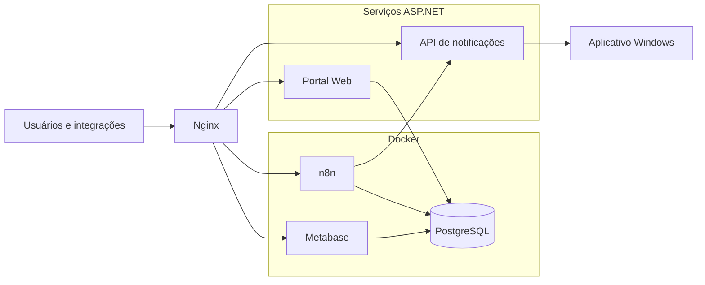

# Infraestrutura

Esta pasta apresenta uma referência sanitizada da infraestrutura utilizada para disponibilizar os serviços do ecossistema.

Os arquivos demonstram a organização de containers, proxy reverso e serviços Linux sem incluir endereços ou credenciais do ambiente original.

---

## Visão geral



---

## Componentes

| Componente | Forma de execução apresentada |
|---|---|
| PostgreSQL | Container Docker |
| n8n | Container Docker |
| Metabase | Container Docker |
| Portal ASP.NET | Serviço Linux com systemd |
| API ASP.NET | Serviço Linux com systemd |
| Nginx | Proxy reverso no servidor |
| Aplicativo desktop | Computadores Windows |

---

## Organização

```text
infrastructure/
├── docker/
│   ├── README.md
│   └── docker-compose.example.yml
│
├── nginx/
│   ├── README.md
│   └── ecossistema.conf.example
│
├── systemd/
│   ├── README.md
│   ├── notificador-api.service.example
│   └── portal-web.service.example
│
└── README.md
```

---

## Docker

A pasta `docker` contém uma topologia demonstrativa para:

- PostgreSQL;
- n8n;
- Metabase;
- volumes persistentes;
- comunicação em rede privada;
- exposição apenas em `127.0.0.1`.

Os serviços não ficam diretamente expostos à internet. O acesso externo é encaminhado pelo Nginx.

[Documentação do Docker](docker/README.md)

---

## Nginx

A pasta `nginx` contém um exemplo de proxy reverso para:

```text
portal.example.com
api.example.com
n8n.example.com
dashboard.example.com
```

Os domínios são apenas demonstrativos.

[Documentação do Nginx](nginx/README.md)

---

## systemd

A pasta `systemd` contém exemplos de serviços para manter o Portal e a API em execução no Linux.

Os serviços incluem:

- inicialização automática;
- reinício em caso de falha;
- configuração externa;
- portas limitadas ao servidor local;
- execução com usuário sem privilégios administrativos.

[Documentação do systemd](systemd/README.md)

---

## Fluxo de acesso

As aplicações são disponibilizadas por subdomínios separados:

| Serviço | Endereço demonstrativo | Destino interno |
|---|---|---|
| Portal | `portal.example.com` | `127.0.0.1:5001` |
| API | `api.example.com` | `127.0.0.1:5000` |
| n8n | `n8n.example.com` | `127.0.0.1:5678` |
| Metabase | `dashboard.example.com` | `127.0.0.1:3000` |

---

## Persistência

Os dados persistentes dos containers utilizam volumes nomeados:

```text
portfolio_postgres_data
portfolio_n8n_data
```

O PostgreSQL armazena:

- dados comerciais;
- banco interno do Metabase;
- banco interno do n8n.

O Metabase e o n8n acessam esses bancos por meio da rede Docker.

---

## Configuração

Os exemplos utilizam variáveis de ambiente.

O modelo geral está em:

```text
../.env.example
```

Os valores reais devem ser mantidos fora do repositório.

---

## Segurança

Os exemplos adotam as seguintes medidas:

- portas dos serviços vinculadas a `127.0.0.1`;
- acesso externo por Nginx;
- credenciais por variáveis;
- arquivos de ambiente fora da publicação;
- processos ASP.NET executados sem usuário administrativo;
- bancos internos separados;
- volumes persistentes;
- configuração sanitizada.

---

## Limitações

Os arquivos são referências de implantação e não uma cópia do servidor original.

Antes de utilizar em produção, devem ser definidos:

- versões fixas das imagens;
- política de backup;
- certificados TLS;
- firewall;
- monitoramento;
- rotação de logs;
- gerenciamento de segredos;
- política de atualização.